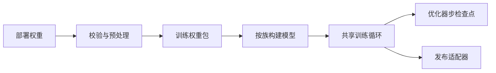
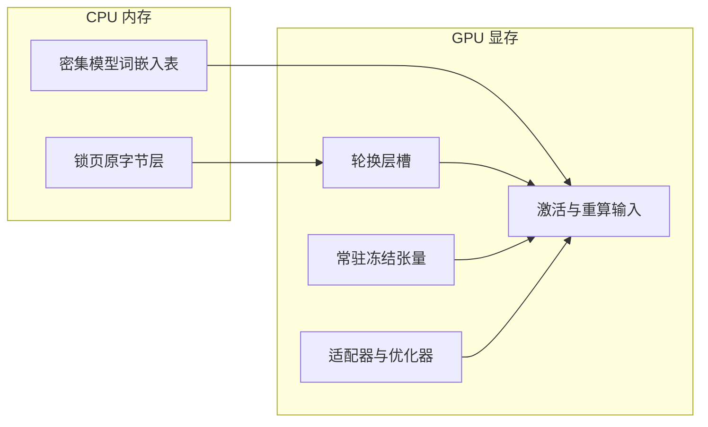
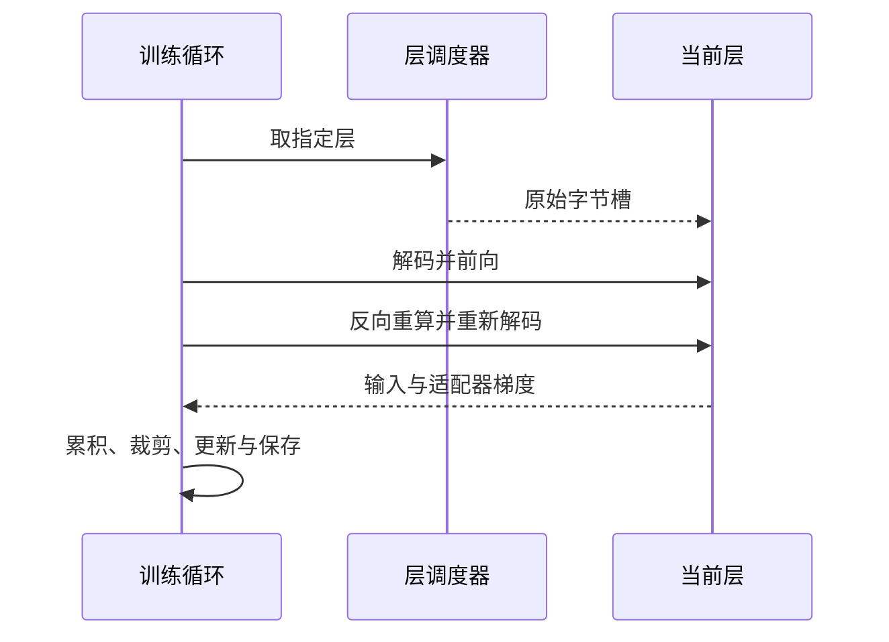

# 总体设计

本文说明部署权重怎样进入训练，以及共享层与模型族实现怎样协作。

MoE（混合专家）和 dense（密集模型）通过同一注册表进入共享训练流程。两族各自负责模型构建和专用格式；共享层负责搬运、训练状态和发布入口，不依赖任一族的实现。

## 权重怎样进入训练

bundle 是预处理后的训练权重包，包含原始量化字节、非流式张量、模型配置和来源哈希。预处理不重新量化部署权重。

层 store 是保存冻结层原始字节的 CPU 存储；streamer 是负责把指定层搬到 GPU 槽位的调度器。两者都按显式层号取数，预取预测只影响速度。实现见 [layer_store.py](../src/nvfp4lora/store/layer_store.py) 与 [streamer.py](../src/nvfp4lora/store/streamer.py)。

## 内存中分别放什么

两族共用层槽和训练状态的放置方式。dense 的 embedding（词嵌入表）保留在 CPU；MoE 的非专家张量常驻 GPU。

NVFP4 是带块缩放的 4 位浮点权重格式，FP8 是 8 位浮点格式。层文件保持这些原始码值；计算时再转为所需浮点精度。

| 内容 | MoE | dense |
|---|---|---|
| 按层流式的权重 | 路由专家的 NVFP4 原字节 | 普通线性投影的 NVFP4／FP8 原字节 |
| 常驻 GPU 的冻结张量 | 注意力、共享专家、词嵌入、输出头及小张量 | 输出头及小张量 |
| 普通 CPU 张量 | 无额外模型张量 | 词嵌入表 |
| 可训练张量 | 线性层 LoRA 和可选专家 LoRA | 线性层 LoRA |

`BuiltModel.frozen_extra` 登记未注册为模型参数或 buffer（不参与优化的注册张量）的冻结张量。冻结指纹同时检查模型参数、buffer、层字节和这些额外张量，见 [frozen_fingerprint](../src/nvfp4lora/train/loop.py)。

## 一个优化器步怎样执行

一个优化器步包含 `accumulation_steps` 条样本；每条样本只监督最后一段答案。实现见 [训练循环](../src/nvfp4lora/train/loop.py)和[分块交叉熵](../src/nvfp4lora/ops/chunked_ce.py)。

1. 前向逐层取层、解码并计算。激活检查点保留重算所需输入，用重算减少显存占用。
2. 从隐藏状态分块计算交叉熵，只生成监督位置的词表分数。
3. 反向重算当前层，重新取层并解码，求输入和 LoRA 梯度。
4. 各样本的交叉熵之和除以监督 token 总数，累积为一次更新。
5. 裁剪梯度，由 AdamW 更新 LoRA，再推进学习率调度器。权重衰减为零。
6. 在完整优化器步边界保存检查点，或输出用于独立重建的发布产物。

常规注意力把 key/value 头展开到 query 头数，再通过[共用实现](../src/nvfp4lora/model/attention.py)调用 SDPA（缩放点积注意力接口），使锁定的 Windows 环境能使用高效后端。GDN（门控 Delta 网络，Qwen 的线性注意力模块）使用 Transformers 的纯 Torch 实现。

## 模块分别负责什么

| 层 | 共享模块 | MoE 模块 | dense 模块 |
|---|---|---|---|
| 族入口 | `families/__init__.py`：身份解析和延迟调用 | `families/moe.py`：配置、路由审核和族约定 | `families/dense.py`：配置、构建校验和族约定 |
| 格式 | `bundle.py`、`policies.py`、`nvfp4.py`、`fp8.py`：字节、策略和解码 | `preprocess_moe.py`：专家与非专家布局 | `preprocess_dense.py`：普通投影与非流式布局 |
| 模型 | `common.py`、`attention.py`、`adapters.py`、`packed_linear.py`：构建结果、注意力和适配器基础 | `build_moe.py`、`packed_experts.py`：模型与专家模块 | `build_dense.py`：模型与普通投影替换 |
| 算子 | `packed_linear_fn.py`、`chunked_ce.py`：冻结线性层与损失 | `experts_fn.py`：专家计算和路由梯度 | 无额外算子 |
| 搬运 | `layer_store.py`、`streamer.py`、`async_streamer.py`：原字节存储与层槽协议 | 无 | 无 |
| 训练 | `session.py`、`loop.py`、`checkpoint.py`、`data.py`、`template.py`、`evaluate.py`：完整训练会话 | 无 | 无 |
| 发布 | `artifacts.py`、`delta_w.py`：发布入口与权重增量指纹 | `artifacts_moe.py`：专家发布格式 | `artifacts_dense.py`：标准线性适配器格式 |
| 验证 | `cpu_gdn.py`、`linear_gradients.py`、`timings.py`：参考与观测基础 | `cpu_layers_moe.py`、路由审核与专家参考 | `cpu_layers_dense.py`、普通投影观测 |
| 夹具 | `testing/numerics.py`：比较与随机状态工具 | `testing/tiny_moe.py`：合成来源 | `testing/tiny_dense.py`：合成来源 |

## 注册表怎样决定模型族

所有入口按显式身份解析，不把某一族设为默认。解析器位于 [families](../src/nvfp4lora/families/__init__.py)。

| 对象 | 判据 | 拒绝情况 |
|---|---|---|
| 来源 checkpoint | `config.json` 的 `model_type` | 未知类型，或内外模型配置冲突 |
| bundle | 完整状态与 `layout_version` | 未知布局、不完整，或声明的族与布局冲突 |
| 发布 adapter | 完整状态与 `layout_version` | 同上，或与 bundle 的族不一致 |
| 训练配置 | 顶层 `family` | 缺失、未知，或与 bundle 不一致 |
| 已构建模型 | `BuiltModel.family` | 缺失或未注册 |

`Family` 保存可调用入口，实际模块在调用时才导入，避免构建、发布和训练之间形成导入环。

| 字段 | 职责 |
|---|---|
| `name`、`short_name` | 规范身份与命令行短名称 |
| `bundle_layout`、`adapter_layout` | 绑定现有两类产物布局 |
| `source_types`、`source_kind` | 识别来源模型并记录来源类型 |
| `preprocess` | 把已校验的来源写成 bundle |
| `logical_config` | 绑定训练、数据、基座和版本身份 |
| `build`、`base_build` | 构建带适配器的模型或只读基座 |
| `route_audit` | 创建族专用审核器；无路由时提供空审核器 |
| `parameter_groups` | 提供优化器参数组及其顺序 |
| `parameter_label`、`audit_passed` | 解释序列化参数和审核结果，供共享摘要器使用 |
| `base_identity` | 返回影响模型函数的 bundle 身份 |
| `publish`、`read_manifest`、`load_adapter`、`read_tensors` | 写入、校验、加载和读取发布格式 |
| `extra_delta_w` | 补充族专用权重增量的指纹 |
| `extra_inventory` | 补充实际持有的族专用张量字节数 |
| `replay_stops`、`evaluation_tokens` | 提供回放生成及训练评测的终止与填充约定 |
| `default_seed` | 提供省略配置时的实际随机种子 |
| `make_tiny`、`quantize_tiny` | 仅生成带合成身份的验证夹具 |
| `fp8_audit`、`decode_frame`、`profiling_targets` | 提供输入范围、显存快照和解码区间的观测入口 |

## 怎样接入新模型族

新增族需要提供专用实现和一条注册记录，共享训练代码不增加分支。检查清单如下：

1. 在各层新增带族后缀的模块，定义来源几何、构建和格式约定。
2. 在 `families` 中提供配置与扩展入口，注册可明确识别的来源和布局。
3. 让 tiny 对参考实现通过，再验证真实模型前向、梯度、续训、发布重建和功能门槛。
4. 运行[分层测试](../tests/test_layering.py)与[身份边界测试](../tests/test_families.py)，确认缺失身份和跨族加载会被拒绝。

共享模块不得导入族专用模块，不得包含族身份或布局字面量；两族专用模块不得互相依赖。只有注册表可以同时知道各族实现，这条规则由 AST（抽象语法树）测试检查。

## 设计边界

核心训练只支持单 GPU、非思考纯文本。两族构建流程和发布格式各自独立，推理由单独的 FreeToken 集成负责；训练与部署的 FP8 激活量化差异见[结果限制](results/qwen3x-27b-dense.md#限制)。
