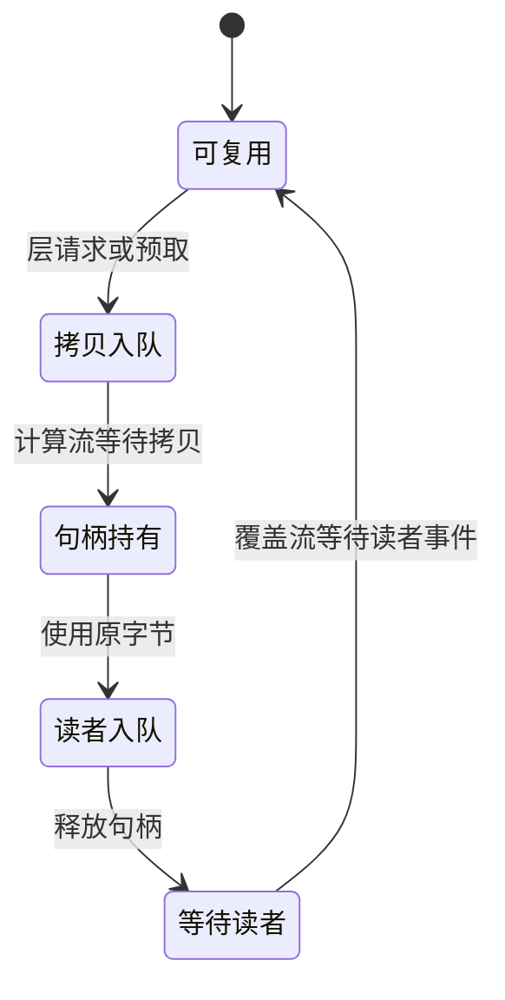

# 按层搬运冻结权重

本文说明 CPU 层存储怎样通过有界 GPU 槽供给前向和反向。

两族共用 `PackedLayerStore`、`SyncLayerStreamer` 和 `AsyncLayerStreamer`。请求中的明确层号决定读取内容，预取预测只影响搬运次数，见[存储](../../src/nvfp4lora/store/layer_store.py)和[异步调度](../../src/nvfp4lora/store/async_streamer.py)。

## 从文件到锁页银行

store 校验层布局与 SHA256，将每层原字节放入持续存活的 CPU 银行。CUDA 异步路径要求这些银行为锁页内存；GPU 只持有两个可复用的原字节槽。

张量视图由层元数据解析到槽中的偏移。解码权重只在当前算子调用内生成，反向重新获取层并解码，不能把全模型浮点权重留到反向。

## 什么条件下可以覆盖槽

| 字段 | 约束 |
|---|---|
| `layer` | 该槽当前对应的明确层号 |
| `generation` | 每次覆盖递增，旧句柄不得再读取 |
| `pins` | 尚未释放的 CPU 句柄数，非零时不能覆盖 |
| `copy_done` | 计算流在读槽前等待的拷贝完成事件 |
| `last_reader` | 拷贝流在覆盖前等待的最后 GPU 读者事件 |

Python 句柄释放只说明最后读取已经入队，不能推断 GPU 已读完。事件和 generation 共同防止异步覆盖；协议入口见 [`acquire`／`release`](../../src/nvfp4lora/store/streamer.py)。

## 预取怎样使用阶段提示

`prefetch_hint` 在前向预测下一层，在反向预测上一层。`phase` 由训练循环设置，算子仍按实际 `layer_id` 请求数据。

预测错误会产生多余搬运；所有槽被持有时预取立即跳过。必须等待的真实请求不能使用预测替代，也不能覆盖有 pin 的槽。

## 同步和异步有什么区别

| 行为 | 同步调度器 | 异步调度器 |
|---|---|---|
| 拷贝 | 当前计算流 | 专用拷贝流 |
| 复用保护 | 同一流顺序及句柄 | 句柄、generation 与 CUDA 事件 |
| 预取 | 提供同一协议 | 尝试与计算重叠 |
| `close()` | 空操作 | 等待相关工作并关闭后续访问 |

两者都必须产出相同的计算结果。异步可重叠不等于真实训练一定提速，需要同配置实测。

## 怎么读搬运统计

`copy_bytes`、`copies`、`cache_hits` 记录传输与命中；异步另记录预取、真实未命中、拷贝 CUDA 区间及获取等待区间。CPU 入队耗时和 GPU 事件耗时是不同口径。

计时结果需等待事件收集，搬运可能与计算重叠，不能直接从总步时减去 H2D 区间当作纯计算。实际层槽、锁页字节和整卡余量分别见 [MoE](../results/qwen36-35b-a3b-moe.md)与 [dense](../results/qwen3x-27b-dense.md)。

## 边界

当前存储在主存中常驻全部量化层，没有运行时 SSD 分页。槽协议围绕单计算流设计；更大模型的分级缓存属于[路线图](../../ROADMAP.md)中的独立工作。
