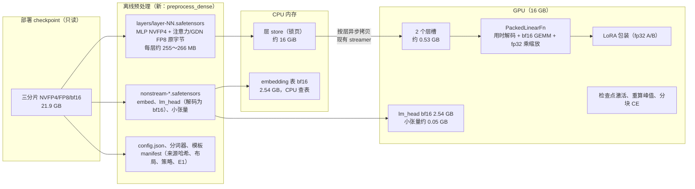
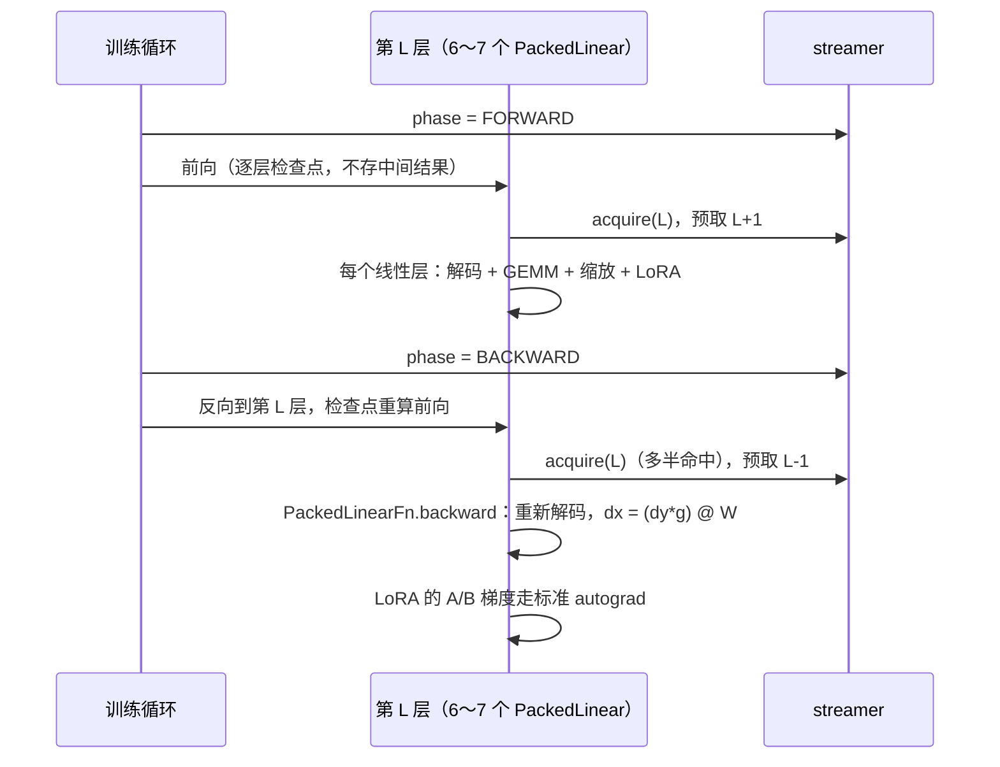

# Dense 27B（Qwen3.6-27B / Qwen3.8-27B）NVFP4 LoRA 训练：特性分支方案 v1

版本 v1　2026-10-29　作者：@macmini1-opus　对应：#文本lora训练可行性与方案分析 task #6
读者：在原生 Windows、RTX 5070 Ti 16 GB、64 GB 主存上，为 `siltok-ai/nvfp4lora` 实现 dense 支持的 codex
读码基线：`siltok-ai/nvfp4lora` main `efdfc55`（数值代码同 `24888c9`）；transformers 5.16.1 `models/qwen3_5`；Speed dev `8da031c`

> **标注**
> - **【已核实】**：读过源码、checkpoint 元数据或仓库证据。
> - **【估算】**：按公式或按 MoE 实测外推，必须在对应阶段实测替换。
> - **【推断】**：根据代码或原理推出，尚未验证。
>
> 「E1/E2/E3」「V1～V4」沿用 `docs/reference/design-v2.md` 的定义：
> - **E1**：原字节一致；
> - **E2**：同一路径逐位一致；
> - **E3**：跨实现在容差内一致；
> - **V1～V4**：梯度正确、可精确续训、adapter 生效、领域效果。

---

## 0. 目标、范围和硬约束

### 0.1 目标

在现有仓库上新开特性分支 `feat/dense27b-lora`，让 dense 的 Qwen3.8-27B 和 Qwen3.6-27B 能在**部署用的 NVFP4 checkpoint 上**训练 LoRA，并沿用现有仓库的验收体系，证明训练流程正确。

| 编号 | 内容 | 本分支 |
|---|---|---|
| G1-D | 在 5070 Ti + 64 GB 原生 Windows 上训练 dense 27B 的 LoRA，有发布产物，V1～V3 全部按类验收 | **完成** |
| G2-D | FreeToken 带 dense LoRA 推理 | **不做**。Speed 推理 27B 需要约 30.4 GB 显存，16 GB 卡加载前就被拒绝；FreeToken 现有的 LoRA 加载器也只支持 MoE |
| G3-D | 领域效果 | **不做** |

### 0.2 两个模型怎么安排

两者的文本结构**完全相同**【已核实：HF 上 text_config 逐项一致、generation_config 一致，参数量都是 27,781,427,952】，所以代码只写一份（family = `qwen3_5_dense`），不认模型名，只认张量布局。

- **Qwen3.8-27B 做完整验收（D0～D7）**。它是 Speed 实际部署的 dense 模型（RadixArk 的 NVFP4）。
- **Qwen3.6-27B 做缩短验收**：预处理、真实前向参考（D5）、首步机制探针，加一次短程训练、发布和重建。是否要跑完整 100 步，到时候问 @liboqi。

### 0.3 和 MoE 部分的关系

@liboqi 2026-10-28 说过「不急于把 MoE 和 dense 锁定在一个框架里」。所以本分支的原则是：

- **dense 的代码放进新文件**；共享文件只做「按 family 分派」的加法；
- **MoE 已验收的数值代码一行不改**；
- MoE 的行为用回归测试证明位级不变（D7）。

### 0.4 硬约束（违反就停下汇报）

1. **训练基座就是部署的 NVFP4 checkpoint 原文件**，按 revision 和三个分片的 sha256 绑定。MLP 的 NVFP4、注意力和 GDN 的 FP8 都**以原字节存放（E1）**，只在用时解码，不转成其他量化格式，也不预先展开成全量 bf16。
2. **只用原生 Windows**，不用、也不探索 WSL；**依赖版本和 `requirements/windows-cu130.lock` 完全相同**（与 Speed 对齐），不新增、不升级依赖。确实需要新依赖时，停下汇报。按 `docs/environment.md` 的规定，已登记的 venv 不与其他 editable checkout 共用：特性分支用**单独的 checkout 和单独的 venv**（同一锁文件、`--require-hashes` 安装），不改原 venv 的 editable 指向。
3. **5070 Ti 上 dense 的 64 层必须按层流式**：打包后约 16.84 GB，放不下 16 GB 显存。
4. **反向时重新取层、重新解码**，不为反向保存解码后的权重。
5. **LoRA 的 B 初始化为 0**；第 0 步开 LoRA 和关 LoRA 的 loss 必须 fp32 位级相同（E2）。
6. **训练提示必须和 Speed 推理提示逐 token 一致**：用 dense checkpoint 自己的分词器和模板，重跑一遍黄金测试。
7. **MoE 零回归**：
   - 现有 MoE 配置（`configs/real-*.json`）经 `logical_config` 得到的配置和哈希不变；
   - 已交付的 MoE 检查点仍能按 `docs/real-training-cli.md` 的命令续训；
   - MoE tiny 训练和真实 MoE 首步 probe 的结果与 main 位级一致（D7）。
8. **发布格式 fail-closed**：dense 发布用新的 `layout_version: "nvfp4-lora-dense-v1"`。现有只认 `nvfp4-lora-v1` 的加载器（包括 FreeToken 分支）遇到它必须报错，而不是误加载。
9. **功能门槛不继承**：`docs/decisions.md` 写明 MoE 的「留出 ≥90%、回放 NLL 增量 ≤0.01」只适用于那一轮。dense 正式 100 步评测之前，先请 @liboqi 确认门槛（D6 的停止点）。
10. 每个阶段验收通过后再进下一阶段；所有偏离写进 `docs/decisions.md`（日期、原文、实测、决定、影响、是否涉及硬约束）。

---

## 1. 模型和 checkpoint 事实

### 1.1 结构【已核实：transformers 5.16.1 `modeling_qwen3_5.py`；Speed `checkpoint.py:79-108`】

| 项 | 值 |
|---|---|
| 训练用的类 | `Qwen3_5ForCausalLM`，配置类 `Qwen3_5TextConfig`（model_type `qwen3_5_text`）；加载时忽略 `^mtp.*`、`^model.visual.*` |
| 规模 | 64 层，hidden 5120，MLP 宽 17408（SwiGLU），词表 248,320，embedding 和 lm_head 不共享 |
| 层类型 | 每 4 层：3 层 Gated DeltaNet（GDN）+ 1 层全注意力；全注意力在第 3、7、…、63 层（16 层），GDN 48 层 |
| 全注意力 | 24 个 query 头、4 个 KV 头，head_dim 256；`q_proj` 输出 12288（query 和输出门控按头交错） |
| GDN | 16 个 k 头、48 个 v 头，每头 128；`in_proj_qkv` 输出 10240（q 2048、k 2048、v 6144） |
| HF 模块名 | `mlp.{gate,up,down}_proj`、`self_attn.{q,k,v,o}_proj`、`linear_attn.{in_proj_qkv,in_proj_z,in_proj_b,in_proj_a,out_proj}`，其余还有 `conv1d`、`A_log`、`dt_bias`、`norm` |
| 关键事实 | **文本路径的 forward 从不直接访问线性层的 `.weight`**（只有视觉塔的 `proj.weight.dtype`），所以可以把线性层整个替换成不持有参数的模块；`Qwen3_5TextModel.forward` 通过 `self.embed_tokens(input_ids)` 取 embedding，也接受 `inputs_embeds` |

### 1.2 部署 checkpoint【已核实：HF 元数据和 index；Speed 合同】

| 候选 | revision（2026-10-28 HF API 读到的） | 说明 |
|---|---|---|
| `RadixArk/Qwen3.8-27B-NVFP4` | `319f741cce68d7914884900c138a1fbb70a42f30` | **Speed 部署的 Qwen3.8-27B 就是这一份的布局**（`checkpoint.py:630` 只接受它的元数据）。Speed 没有固定 revision 和哈希 |
| `nvidia/Qwen3.8-27B-NVFP4` | `482ca0f3832238542f8f5295dde86b5f22711d80` | 张量布局和 RadixArk 完全相同（2194 个键、dtype 一致），只是元数据（ignore 列表、ModelOpt 版本）不同 |
| `nvidia/Qwen3.6-27B-NVFP4` | `0893e1606ff3d5f97a441f405d5fc541a6bdf404` | Qwen3.6-27B 的 NVFP4；Speed 按结构匹配，会当成 `qwen3.8-27b` 加载 |

三份的 `total_size` 都是 21,921,428,072 字节。**先找机器上 Speed 实际在用的那份文件**，算出 sha256，和上表的 HF revision 对照，记录对上的是哪一份；找不到本地副本再从 HF 按固定 revision 下载。预处理按张量 dtype 和键名校验布局，**不依赖** `quantization_config` 元数据，所以 RadixArk 和 nvidia 两种元数据都能通过。

**各模块的格式**（相对 `model.language_model.layers.N.`）：

| 模块 | 格式 | 张量（形状） |
|---|---|---|
| `mlp.gate_proj` / `up_proj` | NVFP4 W4A16，16 个一组 | weight U8 [17408, 2560]、weight_scale E4M3 [17408, 320]、weight_scale_2 F32 []、input_scale F32 [] |
| `mlp.down_proj` | NVFP4 | weight U8 [5120, 8704]、weight_scale E4M3 [5120, 1088]、两个 F32 标量 |
| `self_attn.q/k/v/o_proj`（16 层） | 每张量 FP8 | weight F8_E4M3 [12288,5120] / [1024,5120] / [1024,5120] / [5120,6144]，weight_scale F32 []，input_scale F32 [] |
| `linear_attn.in_proj_qkv / in_proj_z / out_proj`（48 层） | 每张量 FP8 | [10240,5120] / [6144,5120] / [5120,6144]，两个 F32 标量 |
| `linear_attn.in_proj_a/b`、`conv1d`、`A_log`、`dt_bias`、`norm`，各种 RMSNorm、`q_norm/k_norm` | bf16 | 小张量 |
| `embed_tokens`（文本部分） | bf16 | [248320, 5120]，2.54 GB |
| `lm_head`（根上） | NVFP4 | U8 [248320, 2560]，0.715 GB |
| `model.visual.*`、`mtp.*` | — | 不进训练模型；**选择专家和层时必须锚定 `model.language_model.layers.`**，MoE 第一次预处理就因为匹配范围过宽，把 MTP 算了进来 |

格式规则（低 4 位在前、E2M1 码表、16 个一组的 E4M3 块缩放、全局缩放不是 2 的幂、FP8 每张量缩放）和 35B-A3B 完全相同，`format/nvfp4.py`、`format/fp8.py` 的解码可以直接复用【已核实】。

### 1.3 每层打包字节【已核实：按形状精确计算】

| 层类型 | MLP（NVFP4） | 注意力 / GDN（FP8） | 合计 |
|---|---|---|---|
| GDN 层（48 层） | 150,405,120 | 115,343,360 | **265,748,480**（253.4 MiB） |
| 全注意力层（16 层） | 150,405,120 | 104,857,600 | **255,262,720**（243.4 MiB） |
| 64 层合计 | | | **16,840,130,560** |

**锁页内存的取整【推断，按 MoE 实测反推】**：MoE 每层 453 MB，40 层锁页实际占 21.47 GB，正好是 40 × 512 MiB，说明 CUDA 的锁页分配器会把每块向上取到 2 的幂。dense 每层都**小于 256 MiB**（GDN 层只剩约 2.7 MB 余量），64 层应占 64 × 256 MiB = 16 GiB。**不要往层文件里再加东西**（比如那些 bf16 小张量），以免越过 256 MiB 变成每层 512 MiB、共 32 GiB。D0 要实测确认。

---

## 2. dense 和 MoE 的根本区别

| | 35B-A3B（MoE） | 27B（dense） |
|---|---|---|
| 每 token 用到的参数 | 约 3B | 约 25.6B（全部，不含 embedding） |
| 训练计算 / token（前向 + 重算 + 反向求 dx ≈ 6N） | 约 18 GFLOP | **约 154 GFLOP** |
| 每遍要搬的打包权重 | 18.12 GB（专家） | 16.84 GB（全部 64 层） |
| 瓶颈 | 搬运和专家解码 | **算力** |
| 需要的算子 | 路由、分组、路由权重梯度、专家 LoRA | **只有冻结线性层 + LoRA 旁路**，简单得多 |

对实现的含义：
- **按层流式的搬运基本能被计算盖住**。按 G0.2 实测的约 47 GB/s，每遍搬运约 0.36 s；而 2048 token 的前向计算以秒计。
- **每个 micro 要做 3 遍解码**：前向一遍、检查点重算一遍、反向求 dx 一遍。纯 Torch 解码每遍估计 1.3～1.8 s【估算：按 MoE 实测 32.2B 个 NVFP4 元素解码 2.35 s 外推到 17.1B NVFP4 + 7.2B FP8】。短样本时它就是主要开销，长样本时被计算摊薄。
- **没有路由**，所以真实模型的 CPU fp32 参考对照不会出现 MoE 那种 top-k 边界跳变，**原始的无条件 1% 判据应当能通过**（D5）。

---

## 3. 总体设计

### 3.1 组件



### 3.2 新模块和接法

| 组件 | 做什么 | 关键约定 |
|---|---|---|
| `PackedLinear` | 替换 HF 的每个量化 `nn.Linear`（MLP 3 个，注意力 4 个或 GDN 3 个） | **不持有任何 Parameter 或 buffer**；只记录 `layer`、模块相对名（如 `mlp.gate_proj`）、`kind`（`nvfp4` / `fp8`）、in/out 维度和 op 配置 |
| `PackedLinearFn` | 冻结基座的前向和反向 | 见 3.3 节协议 |
| `LoRAPackedLinear` | 在 PackedLinear 外面加 LoRA 旁路 | **模仿 PEFT 的结构**：`base_layer`、`lora_A = ModuleDict({"default": Linear(in, r)})`、`lora_B = ModuleDict({"default": Linear(r, out)})`、`scaling = {"default": alpha/r}`，全部 fp32。这样参数名是 `...q_proj.lora_A.default.weight`，现有 `canonical_name`、`delta_w.py` 的 PEFT 分支都能直接用。另有 `enabled` 开关 |
| `CPUEmbedding` | 替换 `model.model.embed_tokens` | 表作为**普通属性**（不是 Parameter 或 buffer）留在 CPU；`forward(ids)` 为 `F.embedding(ids.cpu(), table).to(ids.device)`（查表结果是原表行的拷贝，和 GPU 查表逐位相同）。HF 的调用方式不变，所以 `train/loop.py`、`model/generate.py`、`train/evaluate.py` **都不用改**。注意：表如果注册成 Parameter，`next(base.parameters())` 会拿到 CPU 设备，现有代码就会出错 |
| `DenseReferenceLinear` | 只供 tiny 使用的参考实现 | 构建时把解码后的码值和缩放常驻（只接受 `tiny-generated` 来源），用普通 autograd 算同一个表达式；**不调用** PackedLinearFn 和 streamer |
| 层 store | 现有 `ExpertStore` 只按 `layout_version == "packed-nvfp4-experts-v1"` 校验 | 改成构造参数 `layout_version`，默认值不变（MoE 零改动）；dense 传 `"packed-dense-layers-v1"`。也可以写一个子类 `DenseLayerStore`。`tensor_views` 只支持 U8/F32，**FP8 权重按 U8 原字节存**，用时 `view(torch.float8_e4m3fn)`，不改 `tensor_views` |
| streamer | `SyncLayerStreamer` / `AsyncLayerStreamer` | **原样复用**。槽按最大层分配（265.7 MB）；dense 每层会 acquire 6～7 次，第一次之后都是命中；预取沿用 `_prefetch_hint` 的阶段规则 |

### 3.3 PackedLinearFn 协议（必须严格遵守）

```python
class PackedLinearFn(torch.autograd.Function):
    @staticmethod
    def forward(ctx, x, layer_id: int, name: str, cfg):
        # x: [..., in]，dtype == cfg.compute_dtype（生产为 bf16）
        with torch.autocast(device_type=x.device.type, enabled=False), cfg.streamer.acquire(layer_id) as h:
            W, g = decode_codes(h.tensors(), name, cfg)   # W: [out, in] 精确码值（bf16 能精确表示）；g: fp32 标量
            prefetch_hint(cfg, layer_id)
            y = (F.linear(x, W).to(cfg.accumulation_dtype) * g).to(x.dtype)
        ctx.layer, ctx.name, ctx.cfg = layer_id, name, cfg
        return y                                              # 不保存 x、W 或任何张量（基座冻结，不需要 dW）

    @staticmethod
    @once_differentiable
    def backward(ctx, grad_y):
        with torch.autocast(device_type=grad_y.device.type, enabled=False), ctx.cfg.streamer.acquire(ctx.layer) as h:
            W, g = decode_codes(h.tensors(), ctx.name, ctx.cfg)   # 重新取层、重新解码
            prefetch_hint(ctx.cfg, ctx.layer)
            grad_lin = (grad_y.to(ctx.cfg.accumulation_dtype) * g).to(ctx.cfg.compute_dtype)
            dx = grad_lin.matmul(W)                                # 和 F.linear 的 autograd 用同一个运算
        return dx, None, None, None
```

- `decode_codes`：
  - NVFP4：`LUT[code] × E4M3 块缩放`，用 `format.nvfp4.dequantize(..., global_scale=None)`，得到的码值在 bf16 里能精确表示，`g = weight_scale_2`；
  - FP8：`weight.view(float8_e4m3fn).to(dtype)`，E4M3 能精确转成 bf16，`g = weight_scale`。FP8 的这个「只解码码值」函数需要新加，不要改现有的 `fp8.dequantize`。
- **限制解码的临时空间**：现有 `nvfp4.dequantize` 内部有 int64 索引和 fp32 中间张量，整块解码 17408×5120 会临时占 1 GB 以上。要**按元素数分块**解码（建议每块 ≤8M 元素），写进一个 bf16 输出张量；`down_proj` 每行有 17408 个元素，按行数分块不够，要按元素数算。解码好的整张 W 最大 178 MB（17408×5120 bf16），用于一次 GEMM。
- **数值策略**（新 id：`dense-packed-linear-bf16code-fp32scale-v1`）：码值精确转 bf16 → bf16 GEMM → 结果转 fp32 乘缩放 → 转回 bf16。NVFP4 和 FP8 两种层用同一个模式。理由：
  - 和 MoE 专家策略同构（全局缩放在 fp32 输出端施加）；
  - 和 FreeToken 推理「缩放乘在输出端」的顺序最接近；
  - 训练看到的权重码值和部署字节逐个对应。

  **这和 MoE 非专家「预先 fp32 乘缩放再转 bf16」不同**，按 family 分别记录，两者对 FreeToken 都只承诺 E3。
- `cfg.compute_dtype` 支持 bf16（生产）、fp32 和 fp64（测试）；`accumulation_dtype` 在 fp64 时为 fp64，其余为 fp32，和 `ExpertOpConfig` 的约定一致。
- 推理时 FP8 层的激活也会被量化（W8A8），训练不模拟，这和 MoE 一样；改用 FP8 越界观测工具量化风险。

### 3.4 LoRA 旁路的语义（与 PEFT 和 FreeToken 一致）

```
base = PackedLinearFn.apply(x, layer, name, cfg)          # bf16
if not enabled: return base
delta = lora_B(lora_A(x.to(fp32))) * scaling              # fp32
return (base.to(fp32) + delta).to(base.dtype)
```

这和 PEFT 的 `result + lora_B(lora_A(x)) * scaling` 再 `.to(result_dtype)` 一致，也和 FreeToken `linear_residual` 的「基座 bf16 输出转 fp32 加增量再转回」一致。B=0 时开关一致（硬约束 5）。

初始化：A 用 PEFT 默认的 `kaiming_uniform_(a=sqrt(5))`，B 为 0；按 PEFT 的方式写，tiny 参考可以直接复制初值。

### 3.5 LoRA 挂载位置

| 方案 | 目标 | r16 参数量 | 张量数 | fp32 + Adam |
|---|---|---|---|---|
| **D-ALL（默认）** | 全注意力 q/k/v/o（16 层）+ GDN `in_proj_qkv`/`in_proj_z`/`out_proj`（48 层）+ MLP gate/up/down（64 层） | **108,789,760**（MLP 69,206,016；注意力 10,485,760；GDN 29,097,984） | 800 | 1.74 GB |
| D-ATTN（备选） | 只挂注意力 + GDN | 39,583,744 | 352 | 0.63 GB |

不挂 `in_proj_a/b`（和 MoE 的 C3、FreeToken 的映射一致）、路由器、embedding、lm_head、norm。默认用 D-ALL：dense 的 MLP 就是普通线性层，研究显示只训注意力明显偏弱。

### 3.6 一层在一个训练步里的经过



每个 micro，每层：搬运 1～2 次（第二次多半命中）、解码 3 次（前向、重算、反向）。

---

## 4. 改动清单

**新增文件**（dense 专用）：

| 文件 | 内容 |
|---|---|
| `src/nvfp4lora/format/preprocess_dense.py` | 布局校验（64 层、每层模块、dtype 和形状，锚定 `model.language_model.layers.`，排除 mtp 和 visual）、按层打包原字节、非流式张量（embed、lm_head 按现有 `_decode_nvfp4_rows` 解码成 bf16、小张量）、config（`text_config`，architectures 设为 `Qwen3_5ForCausalLM`，去掉 quantization_config）、分词器和模板复制、manifest |
| `src/nvfp4lora/ops/packed_linear_fn.py` | `PackedLinearFn`、`decode_codes`（按元素数分块）、op 配置（streamer、compute_dtype、解码块大小） |
| `src/nvfp4lora/model/packed_linear.py` | `PackedLinear`、`LoRAPackedLinear`、`CPUEmbedding`、`DenseReferenceLinear` |
| `src/nvfp4lora/model/build_dense.py` | `build_dense_model(...)`：meta 构造 → 转 bf16 → 替换线性层和 embedding → `to_empty` → 逐张量加载非流式参数 → 重新注册 RoPE → 初始化 LoRA → 核对可训练集合 |
| `src/nvfp4lora/validation/cpu_layers_dense.py` | CPU fp32 逐层流式参考（前 N 层），给 D5 用 |
| `tools/make_tiny_dense.py`、`tools/quantize_tiny_dense.py`、`tools/prepare_tiny_dense.py` | tiny dense 来源：hidden 256、4 层（3 GDN + 1 全注意力）、MLP 512、注意力 4/2 头 × 64、GDN 2/4 头 × 32、词表 2048；MLP 和 lm_head 用 NVFP4 并带非平凡全局缩放，注意力和 GDN 用 FP8 标量缩放；**故意放入 `mtp.*` 和 `model.visual.*` 假键**，测过滤逻辑 |
| `tools/check_tiny_dense_training.py` | 照 `check_tiny_training.py`：生产 vs 两个参考的 100 步、50→100 续训、发布重载 |
| `tools/preprocess_dense_checkpoint.py` | 真实 dense 预处理入口（要求 G0.8-D 收据） |
| `tools/check_dense_forward.py` | D5：加载、CPU 参考、贪心回答、耗时拆分 |
| `tools/check_dense_linear.py` | D2：真实形状的 E2 对照和工作区测量 |
| `configs/dense27b-all-r16.json`、`configs/dense27b-all-r16-4096.json` | 训练配置，带 `"family": "qwen3_5_dense"`；build 键建议为 `{family, lora_rank, lora_alpha, lora_scope, decode_chunk_elements, streaming}`，其余训练键和 MoE 配置相同 |
| `docs/dense/*.md` | 进度、结果、CLI；`docs/decisions.md` 追加记录 |

**修改文件**（只做加法分派，MoE 分支不变）：

| 文件 | 改动 | MoE 不变的保证 |
|---|---|---|
| `store/expert_store.py` | 加 `layout_version` 构造参数，默认值保持原值 | 默认参数 |
| `train/session.py` | `logical_config`：配置里有 `"family": "qwen3_5_dense"` 时，按 dense 的 build 键校验并调用 `build_dense_model`；dense 不建 `ExpertRouteAudit`（或用空实现） | **MoE 配置不加 family 键**，`logical_config` 输出和哈希不变（硬约束 7） |
| `export/artifacts.py` | 新 `base_identity_dense`、`publish_dense_adapter`（自己写 PEFT 格式的 `adapter_model.safetensors` 和 `adapter_config.json`，键为 `base_model.model.` + 规范名）、`read/load/build_from_adapter` 按 layout_version 分派 | 现有函数在 `nvfp4-lora-v1` 下的行为不变 |
| `export/delta_w.py` | 包装模仿 PEFT 结构后，可能**不用改**；如果要改，只加分支 | — |
| `model/adapters.py` | `disable_adapters` 同时切换 `LoRAPackedLinear.enabled` | 没有 dense 模块时行为不变 |
| `tools/fetch_checkpoint.py` | `REPO`/`REVISION` 改成参数，默认值保持 MoE 原值 | 默认参数 |
| `tools/prepare_canary_replay.py`、`tools/audit_fp8_input_ranges.py`、`tools/verify_training_release.py`、`tools/train_lora.py` | 按 family 或 manifest 分派 | 默认 MoE |

**不改**：`ops/experts_fn.py`、`model/packed_experts.py`、`model/build.py`、`format/preprocess.py`、`format/nvfp4.py`、`train/loop.py`、`model/generate.py`、`train/checkpoint.py`、`train/data.py`、`train/template.py`。如果实现中发现必须改，写进决策日志，并在 D7 证明 MoE 位级不变。

---

## 5. 资源和速度预算【估算，D0/D5/D6 实测替换】

### 5.1 显存（5070 Ti，D-ALL r16，batch 1）

| 对象 | 2048 token | 4096 token |
|---|---|---|
| 2 个层槽 | 0.53 GB | 0.53 GB |
| lm_head bf16 + 小张量 | 2.59 GB | 2.59 GB |
| LoRA 参数 + 梯度 + Adam（fp32） | 1.74 GB | 1.74 GB |
| 检查点保存的层输入（64 × T × 5120 × 2 字节） | 1.34 GB | 2.68 GB |
| 单层重算和反向峰值（GDN 主导：MoE 实测 32 个 v 头时 T4096 约 2.2～2.5 GiB，dense 48 个 v 头按 1.5 倍外推） | 约 1.5～2.0 GB | 约 3～4 GB |
| 分块 CE（chunk 128） | 约 0.4 GB | 约 0.4 GB |
| 解码临时空间（一张整矩阵 178 MB + 分块中间量） | 约 0.3～0.4 GB | 约 0.3～0.4 GB |
| **allocated 合计** | **约 8.4～9.0 GB** | **约 11.3～12.4 GB** |

另外 reserved 一般比 allocated 多 1～2 GB，CUDA 上下文还要 0.5～1 GB（不计入 torch）。MoE 专家 r2 在 4096 时是 14.13 / 15.84 GB，只剩 528 MiB；dense 4096 估计比它宽松一些，但仍要实测。

**4096 超预算时的处理顺序**：
1. **O1 检查点卸载到 CPU**：省约 2.7 GB；纯工程，不改数值，可以自行做。
2. **O2 限制 max_length 为 2048**：需要记录。
3. **O3 lm_head 保持 NVFP4，CE 按「词表分块 × 全部监督 token」计算**（在线 logsumexp，反向重算，每次前向和反向各解码一次 lm_head）：省约 1.8 GB。这会改变 lm_head 的数值策略，**先问 @liboqi**。
4. **O4 缩小 LoRA 范围（D-ATTN）或 rank**：改变实验，**先问 @liboqi**。

### 5.2 内存

| 对象 | 大小 |
|---|---|
| 层 store 锁页 | 64 × 256 MiB = 16 GiB（17.18 GB）【推断，D0 实测】 |
| embedding 表（可分页） | 2.54 GB |
| Python、torch、数据、保存缓冲 | 约 5～8 GB |
| O1 检查点卸载（启用时） | 1.3～2.7 GB |
| **合计** | **约 25～30 GB**；预处理峰值要求 ≤16 GB |

磁盘：每个模型约 22 GB 源文件 + 16.8 GB 层 store + 5.2 GB 非流式 bf16，约 45 GB。

### 5.3 速度

- 计算：约 154 GFLOP/token。5070 Ti 的有效 bf16 算力以 D0 实测为准，按 40～60 TFLOPS 估计，约 2.6～3.9 ms/token。
- 解码：每遍约 1.3～1.8 s，每个 micro 3 遍。
- H2D：每遍约 0.36 s（47 GB/s），预取后大部分能盖住。

| 场景 | 每个 micro | 每个优化器步（累积 8） | 吞吐 |
|---|---|---|---|
| 功能语料（约 36 token/条） | 约 5～6 s | 约 40～50 s | — |
| 2048 | 约 10～13 s | 约 80～105 s | 约 150～200 token/s |
| 4096 | 约 15～21 s | 约 120～170 s | 约 190～270 token/s |

100 步功能训练约 1.1～1.4 小时。dense 慢在算力，搬运优化帮不上忙。

**可选优化（本分支不做，除非 @liboqi 要求）**：
- 把同一层「重算时解码出的权重」留到反向用，每层多占约 0.77 GB，省掉 1/3 的解码；
- 用 Triton 融合解码或解码加矩阵乘（见 ROADMAP 第三项；Unsloth `kernels/nvfp4.py` 有 W4A16 前向和 dx 的 Triton kernel 可以参考，但它按 compressed-tensors 的约定用「块缩放 ÷ 全局缩放」，和本项目「输出端乘 weight_scale_2」的舍入位置不同，也不覆盖 FP8 层）。

---

## 6. 分阶段实施

每个阶段写「做什么 → 验收 → 不通过时」。编号前缀 D 表示 dense，验收编号 DA。所有运行都用 `tools/run_recorded.py` 新建运行目录，证据摘要放进 `docs/evidence/dense/`。

### D0　分支、环境、基线和关卡（约 0.5～1 天）

| 编号 | 做什么 | 通过标准 | 不通过时 |
|---|---|---|---|
| DA0.1 | 从 main 最新提交（当前 `efdfc55`）建 `feat/dense27b-lora`，记录基线提交 | — | — |
| DA0.2 | 在新目录（例如 `C:/workspace/envs/T-<日期>-nvfp4-dense/train`）用同一锁文件建 venv（`--require-hashes`，可用 `tools/prepare_environment.py` 保存的离线 wheel），editable 安装特性分支的 checkout；`pip check`；`pip freeze` 和原 venv 逐行比对；在 `registry.json` 登记新路径。原 venv 和主 checkout 不动 | 版本和哈希与锁文件一致，无新依赖 | 需要新依赖就停下 |
| DA0.3 | **MoE 基线 B0**（在 main 上记录，D7 对照用）：(a) 全部单元测试；(b) MoE tiny 100 步（`check_tiny_training.py`）的 metrics 和最终参数；(c) `configs/real-c3.json`、`real-expert-r2.json` 经 `logical_config` 的配置 JSON 和哈希；(d) 真实 MoE 两套配置的初始 probe loss 的 fp32 位 | 全部记录 | — |
| DA0.4（G0.8-D） | 找到机器上 Speed 用的 Qwen3.8-27B NVFP4，算 sha256，和 1.2 节的候选对照；没有就按固定 revision 下载；`fetch_checkpoint.py` 参数化 | 三分片 sha256 和 HF LFS 元数据一致，收据完整 | **不一致就停**，不在未校验的权重上继续 |
| DA0.5（G0.4-D） | 在 meta 上用 `text_config` 构建 `Qwen3_5ForCausalLM`，核对 1.1 节的模块名和形状；在 tiny 上替换线性层和 embedding 后前向能跑 | 一致 | 按实测更新文档 |
| DA0.6（G0.3-D） | dense 形状的 GDN（16 个 k 头、48 个 v 头）纯 Torch chunk 实现：T=2048/4096 的前向、反向和两种检查点模式；对照逐 token 递推参考（短 T）；记录峰值显存和耗时 | 输出和梯度在 E3 内 | 峰值过高就上报（这会改变 5.1 节的预算） |
| DA0.7（G0.5-D） | SDPA 在 B=1、24/4 头、T=4096、head_dim 256 时实际用的后端（有无 padding mask 两种情况），记录峰值显存 | 不是退回 math 实现（math 实现每层注意力分数约 1.6 GB） | math 实现时上报，评估限制长度 |
| DA0.8（G0.6-D） | bf16 GEMM 实测：T×5120 → 17408、T×17408 → 5120、T×5120 → 10240，前向和 dx；纯 Torch 解码一张 gate 矩阵和一张 FP8 矩阵的耗时 | 记录 TFLOPS 和解码 G 元素/s | 用实测替换 5.3 节 |
| DA0.9（G0.2-D） | 按真实层大小分配 64 块锁页内存，记录 `torch.cuda.memory.host_memory_stats()`，测 H2D | 分配成功；记录实际锁页字节（预期 16 GiB） | 如果按 512 MiB 取整（32 GiB），停下汇报，改成「几个大块切片」的分配方式 |

### D1　预处理（约 1 天）

做 `preprocess_dense` 和 tiny dense 夹具；先用 tiny，再处理真实 checkpoint。

| 编号 | 验收 |
|---|---|
| DA1.1 | 布局报告和 1.2、1.3 节完全一致；只选 `model.language_model.layers.*`；mtp 和 visual 被排除（tiny 夹具有假键覆盖这一点） |
| DA1.2 | **E1 全量**：每层每个流式张量都和原分片逐字节比对（dense 每层只有约 266 MB，全量比对成本很低，不只抽样） |
| DA1.3 | MLP NVFP4 解码和 FreeToken `_dequant_nvfp4` 的结果 ≤1 ULP（抽取 gate、up、down 各若干层，可选，用 Speed 环境只读调用）；FP8 码值转 bf16 和 float8→fp32 的值完全相等 |
| DA1.4 | 每层 payload < 256 MiB；index 和每层 sha256 正确；层 store 加载后的哈希可复现 |
| DA1.5 | 预处理峰值内存 ≤16 GB |
| DA1.6 | 非流式文件：embed、lm_head（`nonexpert-fp32-decode-bf16-v1`）、小张量键名完整无多余；config 和分词器文件哈希已记录 |

### D2　PackedLinearFn 和 LoRA 包装（约 1 天）

| 编号 | 验收 |
|---|---|
| DA2.1 | **E2**：10 种真实形状（q、k、v、o、in_proj_qkv、in_proj_z、out_proj、gate、up、down），用真实层权重、T=4096 随机输入，PackedLinearFn 的前向输出和 dx 与「物化 W 后同一表达式的 torch autograd」逐位一致。不一致时先查是否用了同一个运算（`F.linear` 和 `matmul`），不放宽为 E3，除非证明是 cuBLAS 选了不同算法，并记录 |
| DA2.2 | 小形状 fp64 `gradcheck`，NVFP4 和 FP8 两种都过 |
| DA2.3 | fp32 模式对 fp64 参考：相对 L2 ≤1e-6 |
| DA2.4 | 工作区：一次前向加反向的峰值增量 ≤「一张解码矩阵 + 分块中间量」的上界；结束后没有存活的解码权重（内存快照，或 allocated 回到测量前） |
| DA2.5 | 同一输入跑两次，结果逐位一致 |
| DA2.6 | 梯度累积（两次 backward）、重入和非重入两种检查点，和不开检查点相比 E2 |
| DA2.7 | `LoRAPackedLinear`：B=0 时开和关逐位一致；A/B 梯度对照手写表达式的 autograd，E2 |

### D3　层 store 和 streamer（约 0.5 天）

现有 store 和 streamer 的测试用 dense 布局参数化重跑：

| 编号 | 验收 |
|---|---|
| DA3.1 | 随机顺序 acquire 1000 次，GPU 数据和 CPU 源逐字节一致 |
| DA3.2 | 用人为延迟逼出竞争，正在读的槽不会被覆盖 |
| DA3.3 | 故意把预取全部猜错，结果仍正确（和不预取时 E2） |
| DA3.4 | 同步版和异步版的单层前向加反向 E2 |
| DA3.5 | 记录每层 acquire、命中、拷贝字节、等待时间 |

### D4　模型构建和 tiny 端到端（约 1～1.5 天）★ M1-D 的核心

| 编号 | 验收 |
|---|---|
| DA4.1 | 构建：没有残留的 meta 参数；非流式参数键名无多无少；RoPE 重新注册为 fp32；embedding 表不是 Parameter；可训练集合 == 预期（真实模型 D-ALL 为 800 个张量、108,789,760 个元素），全部 fp32 且在 GPU；冻结指纹覆盖 GPU 参数、层 store 和 CPU embedding 表 |
| DA4.2 | **tiny 100 步，两个参考**：(a) 同框架内的 `DenseReferenceLinear`：第 1 步各 LoRA 梯度余弦 ≥0.999，每步 loss 相对误差 ≤2%（预期远小于此），最终 LoRA 余弦 ≥0.99；(b) 独立参考：tiny 的 NVFP4 解码成 bf16（全局缩放预先乘进权重），用 HF `Qwen3_5ForCausalLM` 加标准 PEFT，相同初值、数据和超参；判据同上（E3）。两个参考都记录，(b) 证明我们和标准 PEFT 语义一致 |
| DA4.3 | 新进程从第 50 步续训到 100，十项状态 E2 |
| DA4.4 | 发布后新进程只用「预处理目录 + publish」重建：全部参数字节、固定 probe 的 loss、全部 ΔW 指纹 E2；另外用标准 PEFT 把 publish 加载到 tiny HF bf16 模型上，probe loss 在 E3 内 |
| DA4.5 | 训练前后冻结指纹不变；实际优化器参数集合 == 预期可训练集合 == 发布文件的键 |
| DA4.6 | 中途 MoE 回归：全部单元测试，加 MoE tiny 2 步，和 B0 E2 |

**M1-D 通过条件**：DA0.x、DA1.x（tiny 和真实）、DA2.x、DA3.x、DA4.x 全部通过，或已选定回退方案并且回退通过验收。通过后才在真实 27B 上训练。

### D5　真实 27B 的加载和前向（约 0.5～1 天）

| 编号 | 验收 |
|---|---|
| DA5.1 | 加载后实测显存、内存和锁页字节，填写 5.1、5.2 节的表 |
| DA5.2 | **CPU fp32 参考**：一条 128 token 的提示，CPU 逐层流式计算前 4 层（每次只解码一层；GDN 用独立的逐 token 递推；注意力用 eager fp32），和 GPU 的隐藏状态比较，**每层相对 L2 ≤1%**。dense 没有路由，**用原始的无条件判据**。不通过时排查解码、GDN、注意力后端，不要直接放宽 |
| DA5.3 | 三条短的非思考贪心回答语义正常，紧接 `<|im_end|>` 停止 |
| DA5.4 | 单次前向的耗时拆分：H2D、解码、GEMM、GDN、注意力 |
| DA5.5 | FP8 越界观测（基座）：每个 FP8 来源层统计 max\|x\| / (448 × input_scale) |
| DA5.6 | 模板黄金测试：用 dense checkpoint 的分词器和模板，200 条样本，和 Speed `_prompt_tokens` 逐 token 一致 |

### D6　真实训练（GPU 时间约半天到一天）

| 编号 | 验收 |
|---|---|
| DA6.0 | **语料**：金丝雀训练 300 条和留出 50 条沿用 `canary-replay-v1` 的文本；**回放 300 条必须用 dense 基座自己重新生成**（`prepare_canary_replay.py --family dense`），作为新的语料 id，例如 `canary-replay-qwen38-27b-v1` |
| DA6.1 | 首步机制探针：1 步 × 累积 8；第 0 步 B=0 开关 loss 位级一致；选两层，截取真实激活，PackedLinear 的 dx 和 LoRA 梯度对照参考（同表达式 E2、fp32 参考 E3） |
| DA6.2 | 压力测试：2048 和 4096 各 2 步 × 累积 8，保留首 micro 快照；逐层重算峰值；allocated、reserved 和整卡剩余（`nvidia-smi`）。**4096 时整卡剩余 <1 GiB，就按 5.1 节的顺序处理后重测** |
| DA6.3 | **停止点**：把基座的回放 NLL 和金丝雀留出结果，加上建议门槛（例如留出 ≥90%、回放 NLL 增量 ≤0.01），发给 @liboqi 确认，**确认后**再跑正式 100 步，并在 decisions.md 记录确认原话和时间 |
| DA6.4 | 正式功能训练：D-ALL r16，max_length 2048，累积 8，100 步；第 10/20/50/100 步评测；保存第 20/50/100 步检查点 |
| DA6.5 | 新进程第 50→100 步续训，十项状态 E2 |
| DA6.6 | 发布重建：全部参数、probe、全部 ΔW 指纹 E2 |
| DA6.7 | 功能门槛（按 DA6.3 确认的值）；基座留出应为 0/50 |
| DA6.8 | 带 adapter 的 FP8 越界观测 |
| DA6.9 | 吞吐和耗时汇总；streamer 统计 |

**Qwen3.6-27B**（在 Qwen3.8-27B 完成 DA6.6 之后）：DA0.4、D1、D5、DA6.0 用 3.6 自己的基座重新生成回放、DA6.1，再加一次 10 步的短程训练、发布和重建。跑不跑完整 100 步，问 @liboqi。

### D7　回归、文档和推送（约 0.5 天）

| 编号 | 验收 |
|---|---|
| DA7.1 | **MoE 回归**（对照 DA0.3 的 B0）：全部单元测试通过；MoE tiny 100 步的 metrics 和最终参数 E2；两套 MoE 配置的 `logical_config` 和哈希不变；真实 MoE 两套配置的初始 probe loss 位级相同；已交付 MoE 制品 step50 的续训身份校验通过（不需要真的训练 50 步） |
| DA7.2 | 文档：`docs/dense/progress.md`、`docs/dense/results.md`、`docs/dense/training-cli.md`；`docs/decisions.md` 追加 dense 决策；README 加一段指向 dense 文档的说明，**不改 MoE 的结论文字** |
| DA7.3 | 提交并推送到远端 `feat/dense27b-lora`；**不合并 main，不 force push**；把分支、最终提交、验收汇总和遗留风险报告给 @liboqi |

---

## 7. 停下来问 @liboqi 的情况

1. 任何硬约束（0.4 节）无法满足；
2. 需要新增或升级依赖；
3. G0.8-D 校验不一致，或者找不到可信来源；
4. 锁页内存按 512 MiB 取整，或分配失败；
5. 4096 压力测试即使启用 O1 仍超预算，需要 O3 或 O4；
6. DA5.2 的 1% 判据经排查仍不通过；
7. DA6.3 功能门槛确认（必停）；
8. MoE 回归出现任何非位级一致的差异；
9. 实际耗时比 5.3 节的估算慢 2 倍以上，且原因不明。

---

## 8. 风险

| 风险 | 应对 |
|---|---|
| dense GDN（48 个 v 头）纯 Torch 实现的显存或速度不够 | DA0.6 先测；超预算按 5.1 节处理；FLA 属于新依赖，要先问 |
| SDPA 在 Windows 上对 head_dim 256 退回 math 实现 | DA0.7 先测 |
| 锁页内存取整导致内存翻倍 | DA0.9 先测；可改成少数大块切片分配 |
| 短样本时解码固定开销占主导，训练慢 | 本分支接受；优化见 ROADMAP 第三、四项 |
| FP8 层推理时 W8A8 截断激活，训练没模拟 | DA5.5 和 DA6.8 观测并记录；不在本分支改训练数学 |
| 改共享文件意外影响 MoE | 0.4 节第 7 条加 D7 的完整回归 |
| 27B 训练出的 adapter 现在不能在 5070 Ti 的 Speed 里推理 | 本分支只做 G1-D；推理侧以后在 24 GB 以上的卡上做，FreeToken 那边需要为 dense MLP（`mlp.{gate,up,down}_proj`）加映射，现有加载器只认 MoE 的模块名 |

---

## 9. 不在本分支范围

- FreeToken / Speed 的 dense LoRA 推理（G2-D）、领域评测（G3-D）；
- 性能 kernel（Triton 解码、解码与矩阵乘融合、保留解码权重）、序列打包、FLA；
- 改变 MoE 任何行为；
- 统一 MoE 和 dense 的构建框架（只做分派，不重构）。

---

## 附录 A：形状和数量速查

| 项 | 值 |
|---|---|
| 语言模型参数 | 26.90B（不含 embedding 25.62B） |
| 每层 MLP | 267.4M 参数（NVFP4 打包 150.4 MB） |
| 每层全注意力 / GDN 投影 | 104.9M / 115.3M 参数（FP8 各 104.9 / 115.3 MB） |
| 最大单张矩阵 | gate/up/down，各 89,128,960 个元素，bf16 178 MB |
| D-ALL r16 每层 LoRA | MLP 1,081,344；全注意力 655,360；GDN 606,208 |
| 检查点层输入 | 每 token 655,360 字节 |
| CE（chunk 128） | logits fp32 127 MB/块 |

## 附录 B：关键源码位置

- transformers 5.16.1 `models/qwen3_5/modeling_qwen3_5.py`：`Qwen3_5GatedDeltaNet`（387 行起）、`Qwen3_5Attention`（632）、`Qwen3_5MLP`（707）、`Qwen3_5TextModel`（1136，`inputs_embeds` 和 `embed_tokens`）、`Qwen3_5ForCausalLM`（1578，忽略 mtp 和 visual）、`_init_weights`（816）。
- 本仓库：
  - `model/build.py`（MoE 构建：meta 构造、`to_empty`、RoPE 重新注册、可训练集合核对，dense 照这个流程）；
  - `ops/experts_fn.py`（acquire、预取提示、关闭 autocast 的写法）；
  - `store/*.py`；
  - `export/artifacts.py`、`export/delta_w.py`（PEFT 结构识别）；
  - `train/session.py`（`logical_config` 的绑定键）；
  - `tools/check_tiny_training.py`（tiny 三进程验收的框架）。
- Speed：`silitok_speed/runtimes/freetoken/checkpoint.py`（profile 和 NVFP4 合同）、`backends/freetoken.py`（dense 显存准入）。
